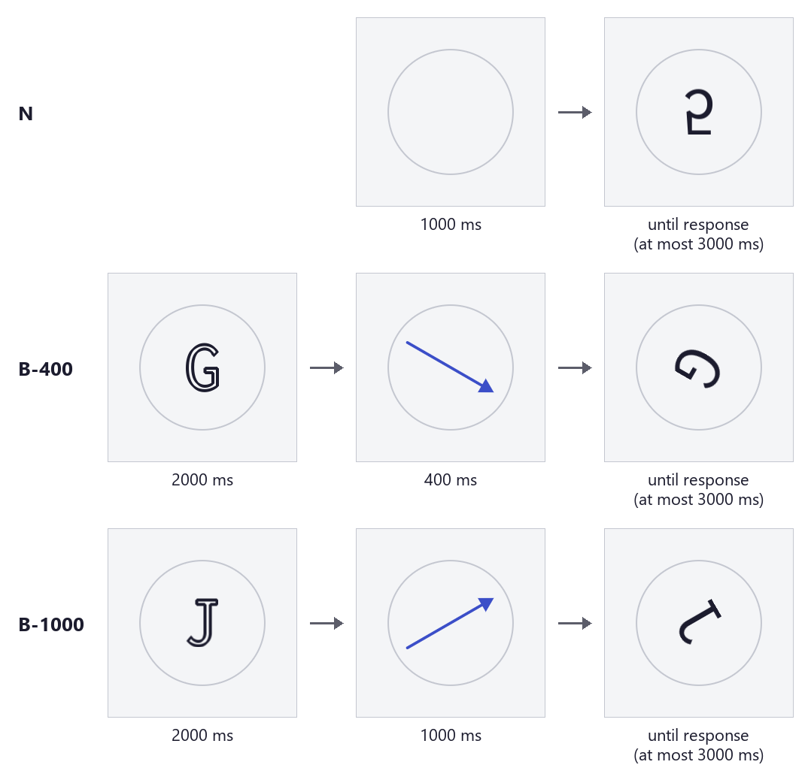

Mental Rotation Preparation
===========================

- Home page: <https://thiago-rissi.github.io/Mental-Rotation-Preparation>
- GitHub repository: <https://github.com/thiago-rissi/Mental-Rotation-Preparation>
- Run the experiment in your browser: <https://thiago-rissi.github.io/Mental-Rotation-Preparation/experiment/>

The aim of this project was to replicate, in a shorter form, an experiment by Cooper and Shepard (1973) on the mental rotation of letters and digits.

In each trial, a letter or a digit is displayed inside a circle, tilted by some angle, and the participant must indicate, by pressing one of two keys, whether it is printed normally or as a mirror image. The response time is recorded. When nothing is known in advance about the character, the response time increases with the angle between the character and its upright position. This is usually taken as evidence that participants rotate a mental image of the character back to upright before comparing it with the normal version stored in memory.

Cooper and Shepard asked whether this rotation can be carried out before the character appears. In some trials, participants were first shown which character was coming and then, for a variable duration, an arrow indicating its orientation. With one second of orientation information, the response time no longer depended on the angle. Our experiment tests whether this result holds with fewer conditions, in a ten-minute session that participants run on their own computer.

**Table of Contents**

- [The original experiment](#the-original-experiment)
- [Design](#design)
- [Stimuli and trial structure](#stimuli-and-trial-structure)
- [Differences from the original study](#differences-from-the-original-study)
- [Running the experiment](#running-the-experiment)
- [Source code](#source-code)
- [Data files](#data-files)
- [Results](#results)
- [References](#references)

## The original experiment

Cooper and Shepard (1973) tested eight participants on six asymmetric characters (G, J, R, 2, 5 and 7), each shown in its normal or mirror-image version at six orientations, from 0 to 300 degrees in steps of 60. The stimuli were presented in a tachistoscope.

Before each test character, participants received one of several kinds of advance information. In condition N, they saw only a blank field for 2000 ms. In the B conditions, they saw the outline of the upcoming character, upright and normal, for 2000 ms, followed by an arrow indicating its orientation for 100, 400, 700 or 1000 ms. The test character appeared as soon as the arrow was removed. In condition C, they saw the outline of the character already rotated to the test orientation for 2000 ms, then a blank field for 1000 ms.

In condition N, the mean response time went from about 570 ms for upright characters to about 1070 ms for characters turned by 180 degrees. The curves of the B conditions became flatter as the arrow duration increased. With 1000 ms of orientation information, the response time was about 400 ms at all orientations, close to condition C. Normal characters were classified 50 to 100 ms faster than mirror-image characters in all conditions.

## Design

The experiment has three conditions, presented in separate blocks. Every participant does all three.

Condition | What is shown before the character
--------- | ----------------------------------
N         | the empty circle, for 1000 ms
B-400     | the outline of the character for 2000 ms, then the arrow for 400 ms
B-1000    | the outline of the character for 2000 ms, then the arrow for 1000 ms

Each condition is crossed with the angular departure of the character from upright (0, 60, 120 or 180 degrees) and with its version (normal or mirror image). For 60 and 120 degrees, half of the characters are turned clockwise and half counterclockwise. Each of the 24 combinations is repeated six times, which gives 144 trials per participant, in six blocks of 24 trials.

The three conditions are presented in one order for the first three blocks and in the reverse order for the last three. This order is one of the six possible orders, chosen from the participant number, so that ten participants cover the six orders almost equally. The response keys are also counterbalanced. Participants with an odd number press J for normal and F for mirror image, and participants with an even number do the reverse.

Each participant first completes six practice trials. The session lasts about ten minutes.

We expect the response time in condition N to increase steeply with the angular departure. If participants use the advance information to prepare a rotated image of the character, the response time in condition B-1000 should depend little on the angle. Condition B-400 should lie between the two, with a cost mainly at the largest angles.

## Stimuli and trial structure

The characters are G, J, R, 2, 5 and 7, as in the original study. They are drawn in near-black on a light background, inside a circular frame. The mirror-image version is obtained by flipping the character horizontally before rotating it. The rotation is done around the centre of the visible character, so that it stays centred in the frame at every angle. The arrow crosses the circle through its centre and points to where the top of the character will be.

After the character appears, the participant has 3000 ms to respond. A wrong answer is followed by the word "Error" for 400 ms, and a missing answer by "Too slow". The next trial starts 500 ms later.

All durations are counted in screen refreshes. When the program starts, it gets the refresh rate of the screen from the system, or measures it in the browser, and converts every duration into a number of frames. Response times are computed from the time stamp of the screen refresh that displayed the character and the time stamp of the key press, both given by the system rather than measured by the program.

## Differences from the original study

To keep the session short enough for volunteers, we changed several aspects of the original procedure:

- we kept three of the six conditions (N, B-400 and B-1000) and dropped B-100, B-700 and C;
- we used four angular departures instead of six orientations, and presented 60 and 120 degrees in both directions, since the original results were symmetric around 180 degrees;
- the blank field of condition N lasts 1000 ms instead of 2000 ms;
- trials with errors are not repeated, and are excluded from the analysis of response times;
- the response keys are counterbalanced across participants;
- the size of the stimuli is relative to the screen, because the viewing distance is not controlled.

## Running the experiment

There are three ways to run the experiment.

### In the browser

Open <https://thiago-rissi.github.io/Mental-Rotation-Preparation/experiment/>, enter your participant number and click Start. You need a computer with a keyboard and Chrome, Edge or Firefox. Keep the tab in front until the end. When the experiment is over, the browser downloads a `.zip` file containing the results.

### With a prebuilt program

Download the file for your system from the [Releases page](https://github.com/thiago-rissi/Mental-Rotation-Preparation/releases) and run it. Nothing else needs to be installed. On Linux and macOS, first make the file executable with `chmod +x`. The program asks for the participant number when it starts. The number can also be given on the command line:

    ./mental-rotation-preparation-linux -s 3

On macOS, the first launch is blocked because the program is not signed. Right-click the file and choose Open, or run:

    xattr -d com.apple.quarantine mental-rotation-preparation-macos-arm64

On Windows, click "More info", then "Run anyway" in the SmartScreen window.

### From the source code

See the next section.

## Source code

The course asked for "le code source *portable* du programme expérimental, pouvant s'installer et s'exécuter facilement sur n'importe quel ordinateur". The experiment is written in [Go](https://go.dev) with the [goxpyriment](https://chrplr.github.io/goxpyriment/) library, which relies on SDL3 for display and keyboard input. Go compiles the program, the font and the SDL libraries into a single executable, so the same source code gives a program that runs without any installation on Linux, macOS and Windows, and in a web browser.

To build and run it from the source, install Go (1.25.7 or later), then type:

    git clone https://github.com/thiago-rissi/Mental-Rotation-Preparation
    cd Mental-Rotation-Preparation
    go run . -s 1

The option `-w` opens the experiment in a window instead of full screen. The executables of the Releases page are built for each tagged version by [release.yml](https://github.com/thiago-rissi/Mental-Rotation-Preparation/blob/main/.github/workflows/release.yml), and the browser version is built and published by [pages.yml](https://github.com/thiago-rissi/Mental-Rotation-Preparation/blob/main/.github/workflows/pages.yml).

The main files are:

- [main.go](https://github.com/thiago-rissi/Mental-Rotation-Preparation/blob/main/main.go): the procedure (instructions, blocks, trials and data logging)
- [config.go](https://github.com/thiago-rissi/Mental-Rotation-Preparation/blob/main/config.go): the conditions, characters, angles, repetitions and durations
- [design.go](https://github.com/thiago-rissi/Mental-Rotation-Preparation/blob/main/design.go): the list of trials and the counterbalancing
- [stimuli.go](https://github.com/thiago-rissi/Mental-Rotation-Preparation/blob/main/stimuli.go): the drawing of the characters, outlines, arrow and frame
- [strings.go](https://github.com/thiago-rissi/Mental-Rotation-Preparation/blob/main/strings.go): the texts shown to the participant, in English and French
- [textinput.go](https://github.com/thiago-rissi/Mental-Rotation-Preparation/blob/main/textinput.go): the answer box of the question asked at the end of the session
- [sheet.go](https://github.com/thiago-rissi/Mental-Rotation-Preparation/blob/main/sheet.go): a sheet showing all the stimuli, to check them by eye (option `-sheet`)
- [autopilot.go](https://github.com/thiago-rissi/Mental-Rotation-Preparation/blob/main/autopilot.go): a test mode in which the program presses the keys itself (option `-autopilot`)
- [keys_notjs.go](https://github.com/thiago-rissi/Mental-Rotation-Preparation/blob/main/keys_notjs.go): the key presses of the test mode in the desktop version
- [keys_js.go](https://github.com/thiago-rissi/Mental-Rotation-Preparation/blob/main/keys_js.go): the key presses of the test mode in the browser version
- [design_test.go](https://github.com/thiago-rissi/Mental-Rotation-Preparation/blob/main/design_test.go): the tests of the list of trials and the counterbalancing
- [stimuli_test.go](https://github.com/thiago-rissi/Mental-Rotation-Preparation/blob/main/stimuli_test.go): the tests of the stimulus geometry
- [strings_test.go](https://github.com/thiago-rissi/Mental-Rotation-Preparation/blob/main/strings_test.go): the tests of the texts
- [web/index.html](https://github.com/thiago-rissi/Mental-Rotation-Preparation/blob/main/web/index.html): the start page of the browser version
- [build.sh](https://github.com/thiago-rissi/Mental-Rotation-Preparation/blob/main/build.sh): the commands that build the desktop and browser versions
- [Makefile](https://github.com/thiago-rissi/Mental-Rotation-Preparation/blob/main/Makefile): shortcuts for building, testing and checking the data
- [scripts/check_data.py](https://github.com/thiago-rissi/Mental-Rotation-Preparation/blob/main/scripts/check_data.py): the checks of the data files (trial counts, accuracy and measured durations)

## Data files

Each session produces a CSV file named `Mental-Rotation-Preparation_sub-<number>_date-<date>.csv`, with one line per trial, and a text file describing the computer and the screen. The desktop version saves both files in the folder `data` of the directory from which the program is started, or in the folder named by the environment variable `GOXPY_DATA` if it is set. It also saves a third file with the participant's answer to the open question asked at the end of the session. The browser version downloads the CSV file and the text file together in a `.zip` file. The files of all participants are stored in the folder [data](https://github.com/thiago-rissi/Mental-Rotation-Preparation/tree/main/data).

The main columns of the CSV file are `condition` (N, B400 or B1000), `character`, `version` (normal or backward), `orientation_deg` (the orientation on the screen, in degrees clockwise from upright), `angular_departure` (0, 60, 120 or 180), `response` (normal, backward or none), `correct` (1 or 0), `rt_ms` (the response time in milliseconds) and `arrow_ms_measured` (the time from the onset of the arrow to the onset of the character, in milliseconds, empty in condition N). Practice trials have `practice` set to 1, and trials without a response have `timeout` set to 1.

## Results

To be completed after data collection.

## References

Cooper, L. A., & Shepard, R. N. (1973). The time required to prepare for a rotated stimulus. *Memory & Cognition, 1*(3), 246-250.

Shepard, R. N., & Metzler, J. (1971). Mental rotation of three-dimensional objects. *Science, 171*(3972), 701-703.
